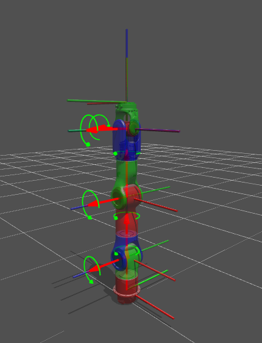
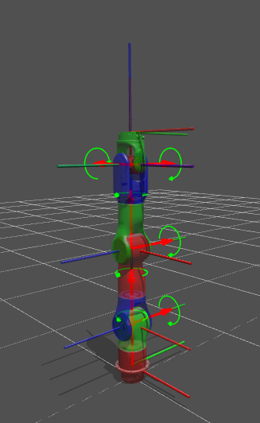

<p align="center">
  
</p>

<h1 align="center">MODI DESCRIPTION</h1>

<p align="center">
  MODI 机器人机型描述包（URDF / meshes）
</p>

<p align="center">
  
  
  
  
</p>

<p align="center">
  <a href="https://github.com/modi-robot/modi_description/releases"><strong>下载模型包</strong></a>
  ·
  <a href="#模型与坐标系"><strong>模型与坐标系</strong></a>
  ·
  <a href="#快速开始"><strong>快速开始</strong></a>
</p>

---

`modi_description` 提供 MODI 各机型的机器人描述资源：URDF、网格、配置与可视化相关文件。
可用于仿真、可视化、运动学/控制栈接入，以及与 `modi_system` / SDK 配套的机型模型分发。

## 主要功能

| 功能 | 说明 |
|---|---|
| 机械臂 URDF | 提供左臂、右臂等独立机械臂模型 |
| 网格资源 | 附带 STL mesh，可直接用于 RViz / Gazebo 等 |
| 坐标系约定 | 发布页展示各机型连杆与关节坐标系分布 |
| 独立分发包 | 按机型打包，解压即可作为独立包名使用 |

## 模型与坐标系

以下图片展示当前公开机型的模型外形与关节/连杆坐标系分布（RGB 轴为局部坐标系，
绿色圆弧箭头示意转动关节方向）。

### `modi_dm3_l`

<p align="center">
  
</p>

### `modi_dm3_r`

<p align="center">
  
</p>

### `modi_dm3_dual`

`modi_dm3_dual` 是聚合配置目录，不包含自身 URDF 或 mesh。其
`config/config.yaml` 按顺序引用 `modi_dm3_l` 与 `modi_dm3_r` 两个独立模型，
运行和打包时必须同时安装这两个模型目录。

## 机械臂限制配置

本项目机械臂 URDF `limit.lower/upper` 为位置范围（rad），`velocity` 为最大速度
幅值（rad/s），`effort` 按项目约定保存最大电流幅值（A）。CoArm7 采用 V1.1，
与 DM3 一样，七轴电流为 `[9.9, 9.9, 12.3, 12.3, 4.9, 4.9, 4.9]`。

每个 `arm.groups[]` 必填 `joint_acceleration_limits`（与 `joint` 同序、等长），
七轴最大加速度均为 `51.8362787842 rad/s²`，即 495 RPM/s；不保存最小加速度。
`end_effector.translation_velocity_limit` 和 `rotation_velocity_limit` 分别为末端
速度模长上限（m/s、rad/s）。这些配置经 RobotConfig 在 WBC 初始化后注入，
由 SDK 从 WBC 查询，双臂 group 分别填写，不从引用的单臂模型继承。

## 支持的机型包

机械臂 `arm.groups[]` 可配置 `gravity_sensor_position: [x, y, z, roll, pitch, yaw]`。
它描述 `T_base_sensor`，位置单位 m、姿态单位 rad，旋转顺序 `Rz(yaw) * Ry(pitch) * Rx(roll)`。
HAL 将静止 MPU 比力取反并乘 `9.80665` 后，通过此旋转得到 base_link 中的测量重力；
不使用平移，也不归一化测量值。字段缺失时默认单位外参，显式值必须是六个有限数值。
DM3 右臂（单右臂与 dual 的 right group）设置 yaw 为 `π/4`；其他臂目前采用零外参。
dual 外参独立配置，不从 `robot` 指向的模型继承。XYZ 为零仅作为位置占位，
与整条机械臂的 base→world 安装位姿不同。

机械臂 `arm.groups[]` 还可配置 `friction_compensation_Scale`，按 `joint` 顺序
为每关节设置 WBC 摩擦补偿比例。长度须与关节数相同，每项为 `[0,1]` 的有限值；
缺省时每关节使用 `0.6`。所有机械臂配置（包括双臂的各 group）均显式配置 `0.6`。
每次实际上电前，服务端从 CanEvo HAL 读取五项摩擦参数和逐关节碰撞残差，
分别调用 WBC `SetFrictionParams`、`SetCollisionResiduals`，并通过
`SetFrictionCompensationScale` 应用此比例；配置失败不继续上电。

当前 GitHub Releases 上传以下机型包：

| 机型 | 说明 |
|---|---|
| `modi_dm3_l` | DM3 左臂 |
| `modi_dm3_r` | DM3 右臂 |
| `modi_dm3_dual` | DM3 双臂聚合配置（依赖左右臂模型） |

## 下载模型包

前往 **[GitHub Releases](https://github.com/modi-robot/modi_description/releases)** 下载所需机型压缩包。

文件名格式：

```text
<机型>_<版本>_<Git短提交>.zip
```

例如：

```text
modi_dm3_l_0.0.1_a1b2c3d.zip
modi_dm3_r_0.0.1_a1b2c3d.zip
```

## 快速开始

### 1. 解压发布包

```bash
unzip modi_dm3_l_*.zip
ls modi_dm3_l/
```

解压后第一层目录为机型名（不是 `modi_description/`）：

```text
modi_dm3_l/
├── urdf/
├── meshes/
└── ...
```

发布包内 URDF 已使用：

```text
package://modi_dm3_l/meshes/...
```

### 2. 作为独立 ROS 2 描述使用

将解压出的机型目录放入某个 ament 包的 `share/<机型>/`（或自建同名包并安装该目录），
保证 `package://<机型>/...` 可被资源解析，然后加载 URDF：

```bash
# 示例：用 check_urdf 校验
check_urdf modi_dm3_l/urdf/modi_dm3_l.urdf
```

在 Launch 中可按机型包名查找资源，例如：

```python
FindPackageShare('modi_dm3_l')
```

## 发布包结构

```text
<机型>_<版本>_<Git短提交>.zip
└── <机型>/
    ├── urdf/                 # 机型 URDF
    ├── meshes/               # STL 等网格
    └── ...
```
独立模型发布包不含 `config/`（仍留在源码仓，供开发使用）。双臂聚合目录
作为 `modi_description` 安装内容分发，并与左右臂模型目录共同使用。

同版本多机型可并存于同一 Release；附件按机型分别下载。

## 问题反馈

使用中发现问题请在 [Issues](https://github.com/modi-robot/modi_description/issues) 提交，并尽量提供：

- 压缩包完整文件名与版本
- 机型名称（如 `modi_dm3_l`）
- 使用场景（RViz / Gazebo / 自研加载器等）
- 可复现步骤与完整报错
